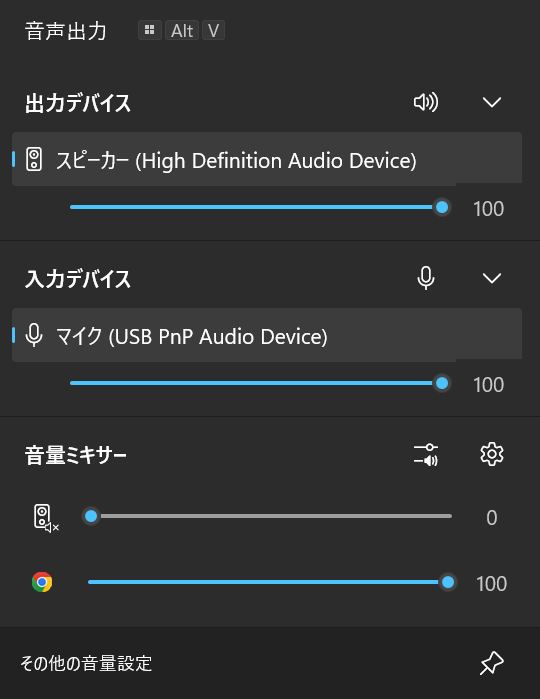

<div align="center">

# mixerplus

**A tiny tray volume mixer for Windows 10/11 that looks like the sound flyout.**

[](https://www.rust-lang.org/)
[](LICENSE)

**English** · [日本語](README.ja.md)



<sub>The popup, exported with <code>--snapshot</code> (see <a href="DEVELOPMENT.md">DEVELOPMENT.md</a>).</sub>

</div>

---

## Features

- **One click away**: click the tray icon to adjust the default output and input, and each app separately. Every slider shows its value and a live level meter.
- **Mute with one click**: the icon in the output or input heading mutes the default device; an app's icon mutes that app.
- **Device switching**: the output and input sections show the default device; their chevron expands them to every device, where you choose the default and set each device's own volume. Each section stays open or closed as you left it, and the expanded output section also offers spatial sound (Windows Sonic for Headphones).
- **Scrolling**: when many apps play sound, scroll the mixer with the mouse wheel or drag the scroll bar.
- **Presets**: save the current volumes and mute states (output, input, every app) under a name and apply them later with one click. Nothing is applied automatically.
- **Native look**: follows the system light/dark mode and accent color. Pure Win32, no runtime to install.
- **Open source credits**: right-click the tray icon: *mixerplus について* shows the license and *Credits* lists every bundled library with its license.

## Install

```powershell
irm https://github.com/valneko-twoon2/mixerplus/releases/latest/download/install.ps1 | iex
```

Installs for the current user (no administrator rights) to `%LocalAppData%\Programs\mixerplus`, starts it, and starts it at every sign-in. Run the same command again to update.

To remove it, use Settings > Apps. Your presets (`%AppData%\mixerplus\presets.json`) are kept unless you run `uninstall.ps1` from the install folder with `-RemoveData`.

## Notes

- Only apps that currently have an audio session are listed; exclusive-mode playback can bypass app volume.
- Switching the default device uses an undocumented Windows interface, so it may stop working after a Windows update.
- mixerplus writes only the presets file and never records audio.

Building from source: see [DEVELOPMENT.md](DEVELOPMENT.md).

## License

MIT. See [LICENSE](LICENSE). Third-party licenses are listed in [THIRD-PARTY-NOTICES.txt](THIRD-PARTY-NOTICES.txt) and in the app (right-click the tray icon > *Credits*).
